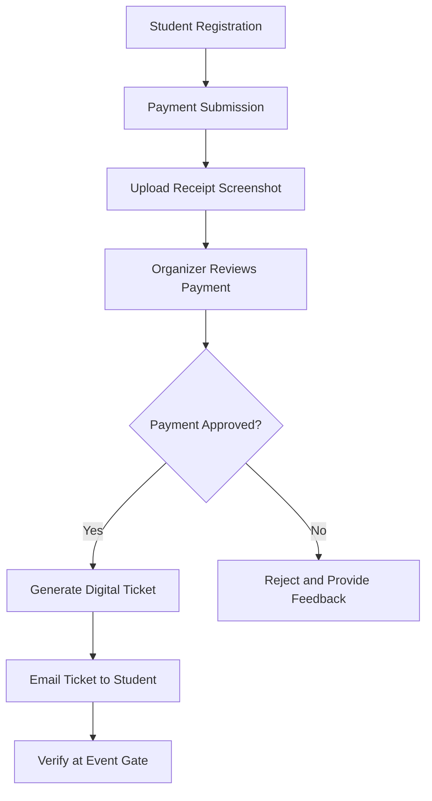

# ✨ CCS Welcome Party & Farewell Gala 2026

<div align="center">

### Computer Cell Society — UET Peshawar

**A modern digital registration and event ticketing platform**

Developed with ❤️ by **Mukhtiar Ahmad**


</div>

---

## 🎉 About the Project

The **CCS Welcome Party & Farewell Gala 2026** website is designed to make event registration, payment verification, and entry management simple and professional for students at the University of Engineering and Technology (UET), Peshawar.

Inspired by the Computer Cell Society's branding, the website uses a modern **deep navy and radiant gold** color palette to deliver an elegant, technology-focused experience.

## 📅 Event Information

| Detail | Information |
|---|---|
| Event | CCS Welcome Party & Farewell Gala 2026 |
| Date | 12 November 2026 |
| Venue | UET Civil Lawn |
| Registration Fee | Rs. 2,200 per person |
| Payment Method | SadaPay |
| Account Title | Abdul Mohaimen |
| Payment Number | `03339729600` |

## 🚀 Key Features

### 📝 Student Registration
- Student name and email address
- Section and semester selection
- CNIC/Form-B information
- Payment screenshot upload
- Registration fee and payment instructions

### 💳 Payment Verification
- Single official SadaPay payment account
- Receipt screenshot submission
- Organizer review and approval workflow
- Ability to approve or reject a registration
- Pending payment review interface

### 🎟️ Digital Tickets
- Unique registration code for each attendee
- QR-style digital ticket
- Ticket details for event entry
- Registration lookup functionality
- Email ticket workflow after payment approval

### 📧 Email Confirmation
After an organizer approves a student's payment, the intended workflow allows the student's digital ticket to be emailed to their registered email address.

**Sender email:** `mukhtiarms@gmail.com`

### 📱 Gate Verification
- Verify a ticket using its unique code
- Check registration and payment approval status
- Mark approved attendees as admitted
- Help prevent duplicate entry attempts

### 🎶 Event Highlights
- Live music and concert performances
- Food, BBQ, and banquet dinner
- Welcome and farewell ceremonies
- Graduation shields and awards
- Photography and entertainment activities
- Socializing and batch celebrations

## 🔄 How It Works

1. **Register:** Students complete the registration form.
2. **Pay:** Students transfer Rs. 2,200 to the official SadaPay account.
3. **Upload:** Students submit a screenshot of their payment receipt.
4. **Verify:** Organizers review the payment evidence.
5. **Approve:** Approved registrations become eligible for a digital ticket.
6. **Email:** The organizer sends the ticket to the registered email address.
7. **Enter:** Event staff verify the ticket code at the gate.



## 🛠️ Technologies Used

- **React** — component-based user interface
- **TypeScript** — type-safe application development
- **CSS** — styling and responsive layouts
- **QR Code / Ticket Interface** — digital pass presentation
- **Git and GitHub** — version control and project hosting

## 💻 Getting Started

### Prerequisites

Install [Node.js](https://nodejs.org/) and npm before running the project.

### Installation

Clone the repository:

```bash
git clone YOUR_REPOSITORY_URL
```

Move into the project directory:

```bash
cd YOUR_PROJECT_FOLDER
```

Install the dependencies:

```bash
npm install
```

Start the development server:

```bash
npm run dev
```

Open the local URL displayed in your terminal.

### Production Build

To build the application for deployment:

```bash
npm run build
```

Replace `YOUR_REPOSITORY_URL` and `YOUR_PROJECT_FOLDER` with your actual repository URL and folder name.

## 🔐 Security and Production Notes

Before using the application for real event registrations, ensure that:

- Student registration records are stored in a secure database.
- Admin pages require authentication and authorization.
- Payment screenshots and CNIC information are protected from public access.
- Ticket codes are generated and validated securely on the server.
- Email delivery is configured with an authorized email service.
- Gate check-in status is saved persistently to prevent duplicate admissions.
- Student information is handled according to appropriate privacy and retention practices.

**Important:** A frontend demo or mock-data implementation does not automatically provide real email delivery, secure payment verification, or shared data persistence. These features require the appropriate backend and service integrations.

## 👨‍💻 Developer

<div align="center">

### Mukhtiar Ahmad

**Computer Science Student | Web Developer**

Building practical digital experiences with modern web technologies.

</div>

## 📌 Project Purpose

This project aims to improve the CCS event experience by bringing student registration, payment review, digital ticketing, and event entry verification into one convenient platform.

---

<div align="center">

### Made for the CCS Community 💻✨

**Computer Cell Society — UET Peshawar**

*Designed and developed by Mukhtiar Ahmad*

</div>
